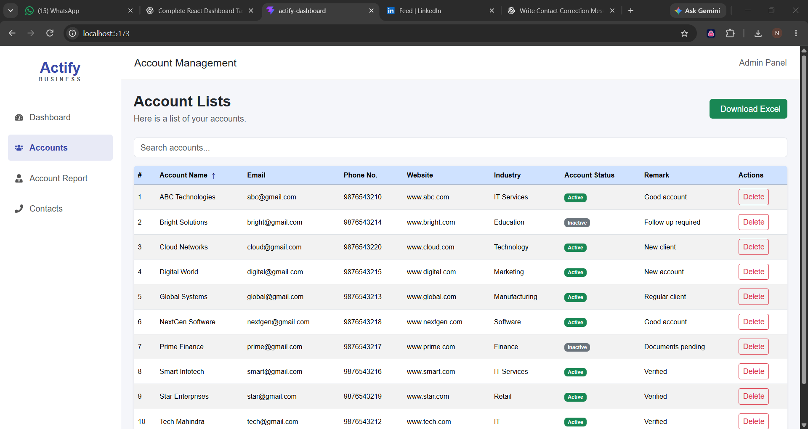
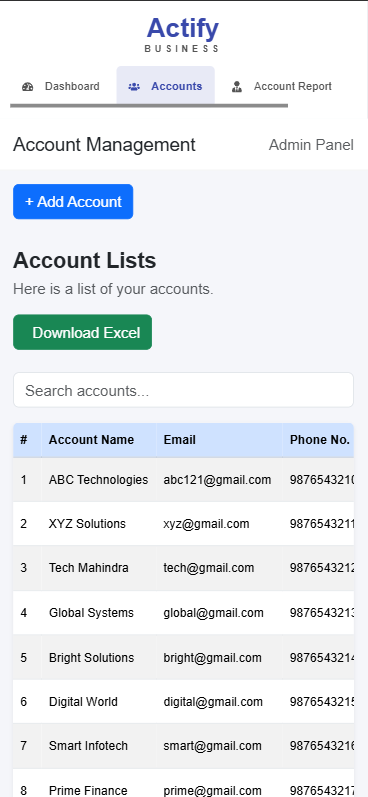

# Actify Business – Account Management Dashboard

A responsive Account Management Dashboard built using React.js. This application provides an interface to manage business accounts with features such as adding, editing, deleting, searching, sorting, pagination, and Excel export.

## 🚀 Features

- **Account Management:** Add, edit, and delete account records.
- **Global Search:** Search accounts across all table columns.
- **Column Sorting:** Sort account records in ascending and descending order.
- **Pagination:** Display 10 records per page.
- **Excel Export:** Export all account records or only filtered search results.
- **Form Validation:** Validate account details using React Hook Form.
- **State Management:** Manage account data using Redux Toolkit.
- **Data Persistence:** Save account changes in browser LocalStorage.
- **Responsive Design:** Optimized for desktop, tablet, and mobile screens.

## 🛠️ Technologies Used

- React.js
- JavaScript (ES6+)
- Redux Toolkit
- React Redux
- React Hook Form
- Bootstrap
- React Icons
- XLSX
- HTML5
- CSS3
- Vite

## 📂 Project Structure

```text
actify-dashboard/
│
├── screenshots/
│   ├── desktop.png
│   └── mobile.png
│
├── public/
├── src/
│   ├── app/
│   │   └── store.js
│   │
│   ├── components/
│   │   ├── AccountForm.jsx
│   │   └── AccountTable.jsx
│   │
│   ├── features/
│   │   └── accounts/
│   │       ├── accountData.js
│   │       └── accountSlice.js
│   │
│   ├── pages/
│   │   └── Dashboard.jsx
│   │
│   ├── App.jsx
│   ├── App.css
│   ├── index.css
│   └── main.jsx
│
├── .gitignore
├── index.html
├── package.json
├── package-lock.json
├── vite.config.js
└── README.md
```

## ⚙️ Installation and Setup

### 1. Clone the repository

```bash
git clone https://github.com/Neha-606/actify-dashboard.git
```

### 2. Navigate to the project directory

```bash
cd actify-dashboard
```

### 3. Install dependencies

```bash
npm install
```

### 4. Start the development server

```bash
npm run dev
```

### 5. Build for production

```bash
npm run build
```

## 📸 Screenshots

### Desktop View



### Mobile View


## 💾 Data Storage

Account records are stored in the browser's LocalStorage so that changes remain available after refreshing the page in the same browser.

This project uses dummy account data and does not require a backend API.

## 👩‍💻 Developer

**Neha Ashok Shingade**

- GitHub: [Neha-606](https://github.com/Neha-606)
- Project Repository: [Actify Dashboard](https://github.com/Neha-606/actify-dashboard)

---

Developed as a React.js Account Management Dashboard assignment.
